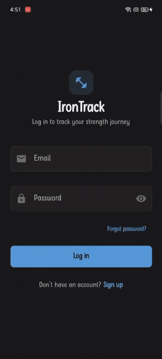

<p align="center">
  
</p>

# IronTrack 🏋️‍♂️

A modern, privacy-first gym and strength workout tracker for Android, built with **Jetpack Compose**, **Material 3**, **Room**, and **Firebase**.

---

## 📱 Features

- **⚡ Active Workout Logging**:
  - Live session timer with elapsed minutes and seconds.
  - Interactive set logging: weight, reps, warmup toggle, and completion checkbox.
  - Built-in rest timer with progress ring and haptic vibration feedback on completion.
  - Rename workouts dynamically or start workouts with default naming.

- **🏆 Automated PR Tracking & Celebrations**:
  - Automatically calculates 1-Rep Max (1RM) using the standard Epley formula:  
    $$\text{1RM} = \text{Weight} \times \left(1 + \frac{\text{Reps}}{30}\right)$$
  - Highlights new personal records during the workout.
  - Displays celebratory dialogs on session finish summarizing newly broken records.

- **📚 Exercise Library**:
  - 24+ built-in exercises categorized by muscle groups (*Chest, Back, Legs, Shoulders, Arms, Core*).
  - Clean sentence-case naming with equipment tags (*Barbell, Dumbbell, Machine, Cable, Bodyweight*).
  - Search exercises and filter by muscle group.
  - Add custom exercises with category, equipment, and default rest timer.
  - Exercise detail sheets showing historical performance, PRs, and recent sets.

- **🔥 Weekly Streak & Goal Tracking**:
  - Weekly consistency card showing workout adherence across Monday to Sunday.
  - Tracks current day streaks and weekly goal progress (e.g. *3 of 4 this week*).

- **📜 Growth History**:
  - Chronological list of completed workout sessions.
  - Displays workout title, date, duration, total volume lifted, and number of sets.
  - Expandable exercise breakdown showing each set performed.

- **⚖️ Body Weight Progress**:
  - Log daily/weekly body weight entries.
  - Track current weight against starting and target weight goals.
  - Interactive weight history chart visualizing trends over time.

- **☁️ Cloud Sync & Offline-First Architecture**:
  - **Local-first**: Uses Android **Room** SQLite database for fast, offline operation.
  - **Cloud backup**: Seamlessly syncs workouts, sets, exercises, and weight logs to **Firebase Firestore**.
  - **Zero-trust security**: Firestore rules guarantee each user can only read and write their own data.

- **🔐 Authentication & Security**:
  - Firebase Authentication with email/password registration and login.
  - Mandatory email verification flow gating access to the application.
  - In-app password change and secure sign-out.

---

## 🛠️ Tech Stack & Architecture

- **UI Framework**: [Jetpack Compose](https://developer.android.com/jetpack/compose) with Material Design 3 (M3).
- **Architecture**: MVVM (Model-View-ViewModel) + Repository Pattern with unidirectional data flow.
- **Concurrency & Streams**: Kotlin Coroutines and `StateFlow` / `Flow`.
- **Local Persistence**: [Room Database](https://developer.android.com/training/data-storage/room) with KSP code generation.
- **Preferences**: [Jetpack DataStore](https://developer.android.com/topic/libraries/architecture/datastore) for unit preferences (`kg` / `lbs`) and default rest timer durations.
- **Cloud Backend**:
  - **Firebase Authentication**: User accounts and email verification.
  - **Cloud Firestore**: Real-time cross-device data backup.
- **Hardware Integration**: Android `Vibrator` / `VibratorManager` for rest timer alerts.
- **Edge-to-Edge**: Fully adaptive insets using `enableEdgeToEdge()` and `WindowInsets.safeDrawing`.
---

## 🚀 Getting Started

### Prerequisites

- **Android Studio**: Ladybug (2024.2+) or newer.
- **JDK**: Version 17 or higher.
- **Android SDK**: Compile SDK `36`, Minimum SDK `24` (Android 7.0+).

### Setup Instructions

1. **Clone the repository**:
   ```bash
   git clone https://github.com/your-username/irontrack.git
   cd irontrack
   ```

2. **Add Firebase Configuration**:
   - Create a project in the [Firebase Console](https://console.firebase.google.com/).
   - Enable **Authentication** (Email/Password) and **Cloud Firestore**.
   - Download `google-services.json` and place it in the `app/` directory:
     ```text
     app/google-services.json
     ```

3. **Deploy Firestore Security Rules**:
   Ensure your Firestore security rules match `firestore.rules`:
   ```javascript
   rules_version = '2';
   service cloud.firestore {
     match /databases/{database}/documents {
       match /users/{userId} {
         allow read, write: if request.auth != null && request.auth.uid == userId;

         match /{document=**} {
           allow read, write: if request.auth != null && request.auth.uid == userId;
         }
       }
     }
   }
   ```

4. **Build the Application**:
   ```bash
   gradle assembleDebug
   ```

5. **Run Local Tests**:
   ```bash
   gradle :app:testDebugUnitTest
   ```

---

## 🧪 Testing

The project includes JVM unit tests verifying:
- Estimated 1RM calculations with varied reps and weights.
- Exercise ID linkages for PR tracking across exercise renames.

Run tests using:
```bash
gradle :app:testDebugUnitTest
```

---

## 📄 License

This project is open-source and available under the [MIT License](LICENSE).
